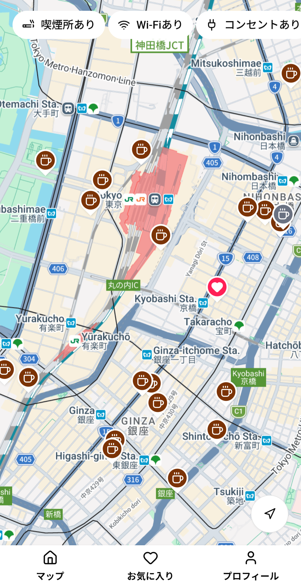
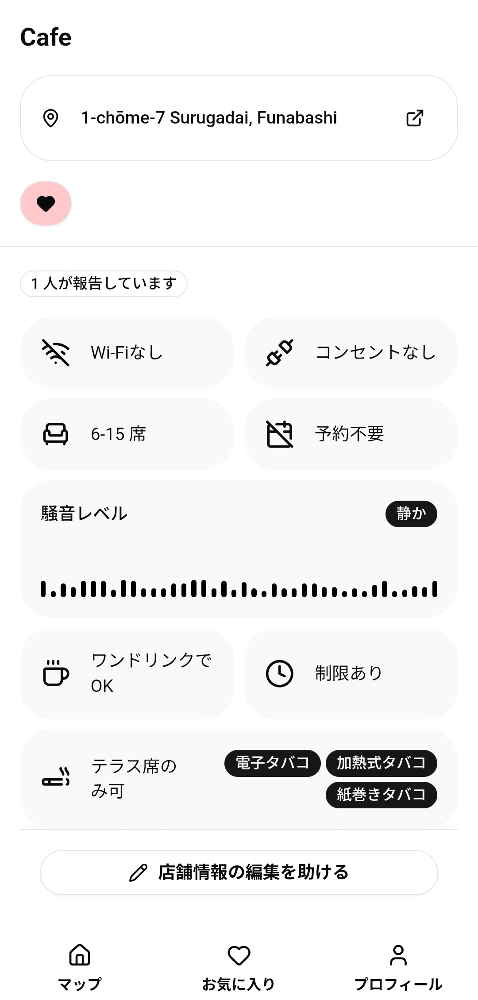

# ☕ Japan Cafe Map

<p align="center">
  
  
</p>

> A crowdsourced map application for discovering **engineer-friendly cafes** across Japan — with real-time Google Maps data and community-driven amenity ratings.


[🌐 Live Demo](https://japan-cafe-map.vercel.app/)

---

## Overview

Japan Cafe Map solves a real problem for remote workers and developers in Japan: **finding cafes where you can actually work**. While Google Maps tells you where a cafe is, it doesn't tell you whether it has outlets, Wi-Fi, or a noise level you can tolerate for a 3-hour deep work session.

This app bridges that gap by pulling cafe data directly from Google Maps and layering it with **community-submitted, engineer-focused ratings** — so you can find the perfect spot before you leave home.

---

## Why I Built This

As a remote developer living in Japan, We often struggled to find cafes
with reliable Wi-Fi, power outlets, and a comfortable working environment.

Most map applications optimize for food and popularity —
not productivity.

Japan Cafe Map was built to help developers and remote workers
discover cafes designed for deep work.

---

## Features

- 🗺️ **Google Maps Integration** — Fetches real cafe listings using the Google Places API, including name, address
- ⭐ **Community Ratings** — Users can rate cafes on attributes that matter to developers:
  - 🔌 Power outlets availability
  - 📶 Wi-Fi quality
  - 🔇 Noise level
  - 🪑 Seating comfort
  - ⏱️ Time limit policy
- 🔍 **Filter & Discover** — Browse and filter cafes by amenity scores to find spots that match your working style
- 📍 **Location-aware** — Centers the map on your current location for quick nearby searches

---

## Roadmap

- Community comments
- AI cafe recommendations

---

## Tech Stack

| Layer      | Technology                             |
| ---------- | -------------------------------------- |
| Frontend   | Next.js, TypeScript, React             |
| Styling    | shadcn / Tailwind CSS                  |
| Maps       | Google Maps JavaScript API, Places API |
| Backend    | Next.js API Routes                     |
| Database   | MongoDB                                |
| ORM        | Prisma                                 |
| Deployment | Vercel                                 |

---

## Architecture Highlights

- **Browser-side Places search** — the Maps JavaScript API finds nearby cafes, then a Next.js API upserts them by Google Place ID. Existing cafe records are not automatically refreshed from Google.
- **Authenticated contributions** — report and favorite APIs use the verified session identity. Successful reports refresh cafe details and member state; failed submissions retain the form input.
- **Community aggregation** — boolean fields use a strict majority, categories use the mode, and tobacco types use a frequency threshold. Unknown values remain distinct from false; each user can report a cafe once.
- **Request-time database checks** — pages render dynamically so an outage during build does not permanently bake the database-unavailable screen into static output. Reload after database recovery to retry.

---

## Getting Started

### Prerequisites

- Node.js 24 recommended (checked with 24.13.0); the installed Next.js 16.1.4 requires at least Node.js 20.9
- pnpm, using the committed `pnpm-lock.yaml`
- A [Google Cloud](https://console.cloud.google.com/) project with the **Maps JavaScript API** and **Places API** enabled
- MongoDB supporting transactions (for example, a replica set or MongoDB Atlas), plus a Resend account for password-reset emails

### Installation

```bash
git clone https://github.com/ZekeGan/japan-cafe-map.git
cd japan-cafe-map
pnpm install --frozen-lockfile
```

### Environment Variables

Create a `.env` file in the root directory so both Prisma CLI and Next.js can load the configuration. Environment files are ignored by Git; never commit actual credentials.

```env
NEXT_PUBLIC_GOOGLE_MAPS_API_KEY=your_browser_maps_key
DATABASE_URL=your_mongodb_connection_string
JWT_SECRET=your_random_server_secret
RESEND_API_KEY=your_resend_key
NEXT_PUBLIC_APP_URL=http://localhost:3000
```

Restrict the browser Maps key by allowed websites and APIs in Google Cloud. Keep `DATABASE_URL`, `JWT_SECRET`, and `RESEND_API_KEY` server-only. Set `NEXT_PUBLIC_APP_URL` to the actual local origin/port or production HTTPS origin; it is used in password-reset links. Restart the local server after configuration changes.

The current sender is `onboarding@resend.dev` in `src/lib/mail.ts`. This sender can send real mail only to the email associated with your Resend account. To support other recipients, verify a domain in Resend and change the sender to an address on that domain. A successful test to `delivered@resend.dev` does not verify delivery to a real inbox.

Generate the database client before the first development run:

```bash
pnpm exec prisma generate
```

Client generation does not synchronize database schema or indexes. For an existing installation, confirm the database is already provisioned; plan schema/index changes and backups separately.

### Run Locally

```bash
pnpm run dev
```

Open [http://localhost:3000](http://localhost:3000) to view the app.

### Checks and Production Build

```bash
pnpm check
pnpm build
pnpm start
```

Run the targeted regression tests with Node.js 24 (the verified runtime). They use isolated database/mail boundaries and do not send email. The build generates Prisma client and Next.js output and may require network access for Google fonts. Runtime page rendering needs an available database. In production, configure the environment variables in the hosting platform; do not use the local reset-link origin.

This is a small personal showcase maintained on demand. See [maintenance instructions](docs/maintenance.md), [architecture](docs/architecture.md), and [current issues](docs/project-status.md). Full refactoring, performance architecture changes, and a comprehensive automated test suite remain deferred.

---

## Author

**Zeke Gan** — [GitHub](https://github.com/ZekeGan)
